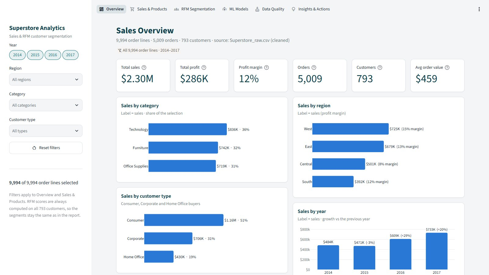
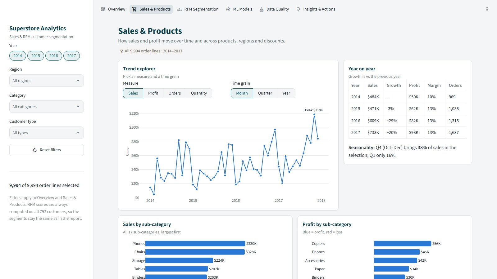
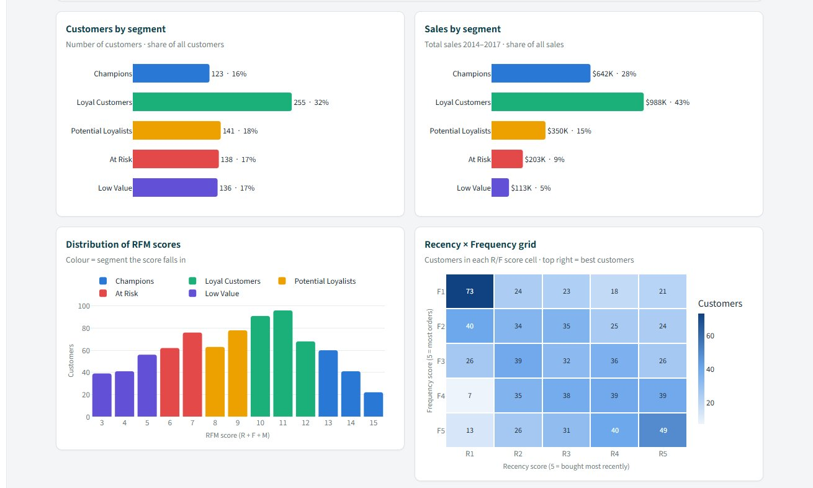
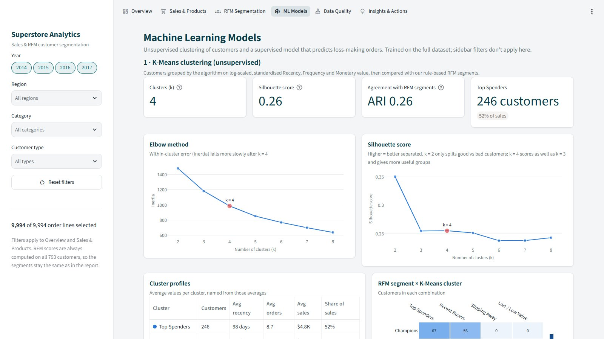
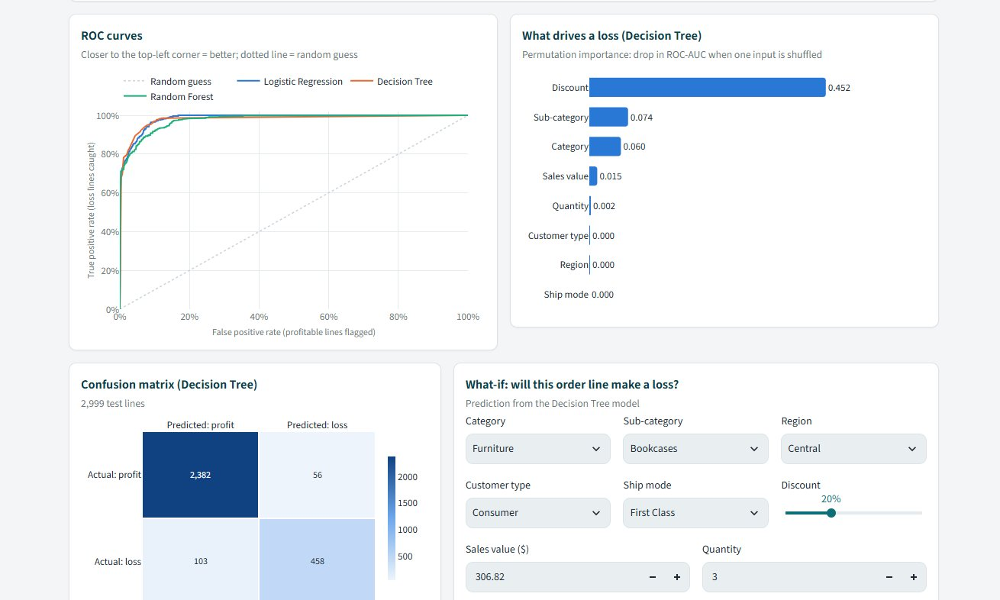
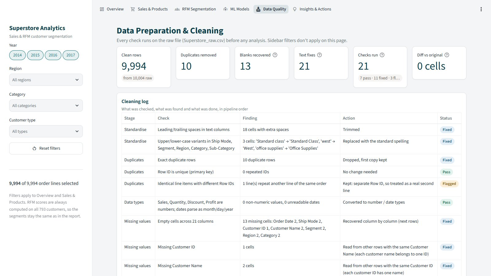
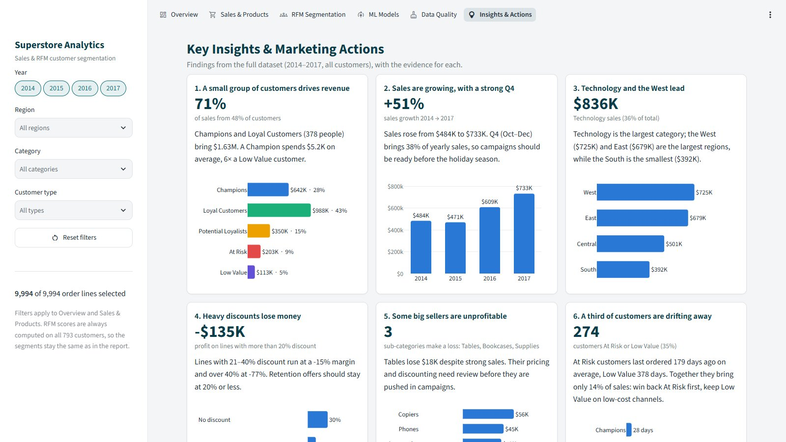

# Customer Segmentation and Sales Analysis Using RFM Analytics

Marketing Analytics project · Module 1: data cleaning, sales analysis, RFM customer segmentation, machine learning
and an interactive dashboard.

**Team:** Sangram Lembe · Surya S · Manavendra A · Manne Subhash

## View the dashboard online (no installation)

### **https://superstore-rfm-customer-segmentation.onrender.com**

Open the link in any browser. It is hosted on a free plan, so if nobody has used it for 15 minutes the first load
takes about a minute while it wakes up. After that it is fast.

| Page | Direct link |
|---|---|
| Overview | https://superstore-rfm-customer-segmentation.onrender.com/ |
| Sales & Products | https://superstore-rfm-customer-segmentation.onrender.com/sales |
| RFM Segmentation | https://superstore-rfm-customer-segmentation.onrender.com/rfm |
| ML Models | https://superstore-rfm-customer-segmentation.onrender.com/ml |
| Data Quality | https://superstore-rfm-customer-segmentation.onrender.com/data-quality |
| Insights & Actions | https://superstore-rfm-customer-segmentation.onrender.com/insights |



## What the project does

We analyse the **Sample Superstore** dataset (9,994 order lines, 5,009 orders, 793 customers, 2014–2017):

1. **Clean** the raw file: remove duplicates, recover blank cells, fix text errors (result: 0 differences from the
   original dataset).
2. **Analyse sales**: categories, regions, customer types, monthly trend, sub-category profit, discounts.
3. **RFM segmentation**: score every customer on Recency, Frequency and Monetary value and group them into five
   segments (Champions, Loyal Customers, Potential Loyalists, At Risk, Low Value), each with a marketing action.
4. **Machine learning**: K-Means clustering checks the segments; Logistic Regression, Decision Tree and Random
   Forest predict loss-making orders.
5. **Dashboard**: all of the above in an interactive Streamlit app with filters.

**Key results:** Champions and Loyal Customers are 48% of customers but bring 71% of sales · sales grew 51% from
2014 to 2017 and Q4 brings 38% of each year's sales · discounts above 20% lost $135K · K-Means clusters line up
with the RFM segments · the Decision Tree catches 82% of loss-making orders (vs 71% for a simple discount rule).

## Screenshots

| Sales & Products | RFM Segmentation |
|---|---|
|  |  |
| **ML Models: K-Means clustering** | **ML Models: loss prediction and what-if** |
|  |  |
| **Data Quality** | **Insights & Actions** |
|  |  |

## Run it on your own computer

### Step 1: install Python (one time)

Download **Python 3.12** from https://www.python.org/downloads/ and install it.
On Windows, **tick "Add python.exe to PATH"** on the first screen of the installer.

### Step 2: download the project

- Easiest: on this GitHub page click the green **Code** button → **Download ZIP**, then extract the ZIP.
- Or with git: `git clone https://github.com/SANGRAMLEMBE/Superstore-RFM-Customer-Segmentation.git`

### Step 3: install the libraries (one time)

Open a terminal **inside the project folder**:

- Windows: open the folder in File Explorer, click the address bar, type `cmd` and press Enter.
- Mac: right-click the folder → **New Terminal at Folder** (or open Terminal, type `cd `, drag the folder into the
  window and press Enter).

Then run:

```bash
pip install -r requirements.txt
```

### Step 4: start the dashboard

```bash
python -m streamlit run dashboard/app.py
```

On Windows you can instead **double-click `run_dashboard.bat`**.

Your browser opens **http://localhost:8501** with the dashboard. If it doesn't, open that address yourself.
Keep the terminal window open while you use it; press **Ctrl + C** in the terminal (or close the window) to stop.

### Troubleshooting

| Problem | Fix |
|---|---|
| `python` or `pip` is not recognized | Python is not on PATH: reinstall and tick "Add python.exe to PATH", or use `py -m pip install -r requirements.txt` and `py -m streamlit run dashboard/app.py` |
| Mac says `pip: command not found` | Use `pip3` and `python3` instead |
| It opens on `localhost:8502` instead of 8501 | Another copy is already running; close the older terminal window, or just use the new address |
| A page shows an error after you edited the code | Stop the dashboard (Ctrl + C) and start it again |

## How to use the dashboard

- **Top menu**: switch between the six pages.
- **Left sidebar filters** (year, region, category, customer type): every KPI and chart on **Overview** and
  **Sales & Products** updates. Try Region = West and Category = Technology: total sales change to $252K.
  Press **Reset filters** to go back. RFM, ML, Data Quality and Insights always use all data so the segments
  stay the same.
- **Hover** over any chart to see exact values; use the camera icon on a chart to download it as an image.
- **RFM Segmentation**: pick a segment in "Customer map" to highlight it; search any customer in the
  "Customer list" and download the scored list as CSV.
- **ML Models → What-if**: choose a product, region, discount and quantity to see the chance that the order makes
  a loss, next to what actually happened for similar past orders. Example: Furniture → Tables at 30% discount
  gives about 90%; at 0% discount it drops to 0%.

### What each page shows

| Page | Visualizations |
|---|---|
| **Overview** | KPI cards (sales, profit, margin, orders, customers, average order value); sales by category, region, customer type and year; monthly sales trend; data table with download and data dictionary |
| **Sales & Products** | Trend explorer (sales, profit, orders or quantity by month, quarter or year); year-on-year table; sales and profit by sub-category; region × category heatmap; profit margin by discount level; top 10 products |
| **RFM Segmentation** | How the score is built; customers and sales per segment; RFM score distribution; Recency × Frequency grid; customer map (recency vs spend); segment profile and action table; searchable customer list |
| **ML Models** | K-Means elbow and silhouette charts, cluster profiles, RFM segment × cluster heatmap; model comparison table, ROC curves, feature importance, confusion matrix, what-if predictor; churn check result |
| **Data Quality** | Raw vs clean row counts, full cleaning log, column profile, comparison with the original file, cleaned data download |
| **Insights & Actions** | Six findings with a number, explanation and chart each; marketing plan per segment; next steps |

## What's in this repo

| Path | What it is |
|---|---|
| `dashboard/app.py` | The dashboard: sidebar filters and 6 pages |
| `dashboard/preprocessing.py` | Cleaning pipeline (duplicates, missing values, text fixes, checks, outliers) |
| `dashboard/rfm.py` | RFM calculation, quintile scoring and segment rules |
| `dashboard/ml.py` | K-Means clustering, loss-making order prediction, churn check (scikit-learn) |
| `dashboard/charts.py` | All Plotly charts and the colour theme |
| `Superstore_raw.csv` | Raw data the dashboard loads (10,004 rows, with duplicates, blanks and text errors) |
| `Sample - Superstore.csv` | Original dataset, used to verify the cleaned data (0 differences) |
| `Superstore_RFM_Customer_Segmentation.pptx` | Presentation deck (17 slides, with speaker notes) |
| `docs/screenshots/` | Dashboard screenshots used in this README |
| `requirements.txt` | Python libraries the project needs |
| `run_dashboard.bat` | Starts the dashboard on Windows |
| `render.yaml`, `Procfile`, `.python-version` | Settings for online hosting |
| `.streamlit/config.toml` | Dashboard colour theme |

## RFM method

| Measure | Definition | Score |
|---|---|---|
| Recency | Days from the last order to 31 Dec 2017 (day after the last order) | 5 = most recent 20% |
| Frequency | Number of unique orders | 5 = top 20% |
| Monetary | Total sales | 5 = top 20% |

RFM score = R + F + M (3–15): Champions 13–15 · Loyal Customers 10–12 · Potential Loyalists 8–9 ·
At Risk 6–7 · Low Value 3–5.

## Machine learning

| Model | Type | Result |
|---|---|---|
| K-Means (k = 4) on log-scaled, standardised R, F, M | Unsupervised clustering | 4 clusters that line up with the RFM segments (silhouette 0.26, ARI 0.26) |
| Logistic Regression, Decision Tree, Random Forest | Supervised classification: will an order line make a loss? | Decision Tree catches 82% of loss lines vs 71% for a "discount > 20%" rule (F1 0.85); discount is the main driver |
| Random Forest churn check | Supervised classification: no order in the next 6 months? | ROC-AUC 0.52 (no better than chance), so not used |

## Deploy your own copy online (free, on Render)

1. Sign in at **render.com** with GitHub.
2. Click **New → Web Service**, pick this repository, and set:
   - Language `Python 3`, Branch `main`
   - Build command `pip install -r requirements.txt`
   - Start command `streamlit run dashboard/app.py --server.port $PORT --server.address 0.0.0.0 --server.headless true`
   - Instance type **Free**
3. Click **Deploy**. After a few minutes the app is live at `https://<service-name>.onrender.com`.
   Every push to `main` redeploys it automatically.

(Or use **New → Blueprint**, which reads the same settings from `render.yaml`.)
